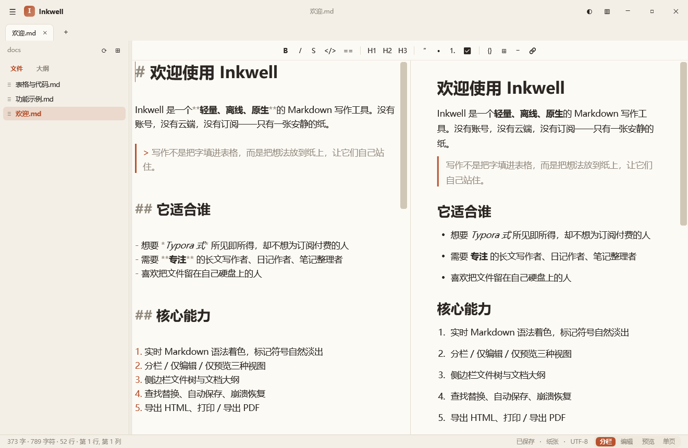

# Inkwell

一个离线、原生、轻量的 Windows Markdown 编辑器。单文件 exe，打开即写，不需要账号、云同步或订阅。

界面语言为中文，目标是把 Typora 式「所见即所得」的安静写作体验，做成一个可以揣在 U 盘里的小程序。



## 功能

- **实时 Markdown 着色**：标题、粗体、斜体、删除线、高亮、行内代码、链接、引用、列表、任务列表、表格、代码块；源码标记会淡出。
- **四种视图**：分栏、仅编辑、仅预览、单页（所见即所得）；编辑区支持鼠标滚轮，分栏时两侧滚动双向联动。状态栏右下角有常驻的分栏 / 编辑 / 预览 / 单页切换按钮。
- **实时预览**：输入时预览持续刷新（短文档约每 55 ms 一次，长文档自动降频），仅编辑或单页模式下暂停渲染。
- **单页模式**（`Ctrl+Alt+4`）：标题、粗体、斜体、行内代码、引用、代码块直接以成品样式呈现，语法符号自动隐藏；光标所在行会重新显示该行标记，方便修改。代码围栏（```）在非光标行完全收起，只保留带内边距的代码块；光标移入围栏行时仍可编辑语言标记。文本始终是纯 Markdown，保存、撤销、查找的偏移都不受影响。
- **语法高亮**：内置着色器覆盖关键字、类型名、函数名、字符串、数字、注释、标签、属性、运算符等类别，编辑器与预览一致；纸张 / 羊皮纸 / 夜间三套配色各自调校。
- **文件工作区**：多标签、文件树、文档大纲（点击跳转）、最近打开、拖放文件打开。
- **查找替换**：`Ctrl+F` / `Ctrl+H`，浮动查找栏、区分大小写、全部替换、`Enter` / `Shift+Enter` 跳转。
- **安全网**：5 秒自动备份、崩溃后恢复未保存内容、关闭前提示保存。
- **导出**：独立 HTML（可内嵌图片）、通过系统打印对话框导出 PDF。
- **图片**：粘贴剪贴板图片或拖入图片，自动存入文档旁的 `assets\` 并插入相对路径。
- **主题**：纸张、棕褐、夜间；正文宽度、字号可调。
- **专注模式**（`F11`）与**打字机模式**（`Ctrl+Shift+Y`）。

## 运行

双击 `Inkwell.exe`。

- 系统要求：Windows 10 / 11（需要 .NET Framework 4.7.2 或更高；Windows 10 1803 起自带 4.8）。
- 也可以把 Markdown 文件拖到 exe 上，或执行 `Inkwell.exe 笔记.md`。
- 关闭时自动保存会话，下次启动会恢复上次的标签页。
- 无界面导出：`Inkwell.exe --export-html out.html note.md`。

### 便携模式

发行包默认附带一个空的 `portable.txt`：配置与备份写在 `Inkwell.exe` 同目录的 `data\` 下，整个文件夹可以放在 U 盘里带走。删除 `portable.txt` 即切换为下面的用户目录模式。

默认（非便携）数据位置：

```
%APPDATA%\Inkwell\
  settings.json   设置
  backups\        自动备份
```

## 快捷键

| 操作 | 快捷键 |
| --- | --- |
| 新建 / 打开 / 保存 / 另存为 | `Ctrl+N` / `Ctrl+O` / `Ctrl+S` / `Ctrl+Shift+S` |
| 关闭标签 / 下一个标签 / 上一个标签 | `Ctrl+W` / `Ctrl+Tab` / `Ctrl+Shift+Tab` |
| 查找 / 替换 | `Ctrl+F` / `Ctrl+H` |
| 加粗 / 斜体 / 删除线 / 行内代码 | `Ctrl+B` / `Ctrl+I` / `Ctrl+Shift+X` / `Ctrl+E` |
| 标题 1–6 / 正文 | `Ctrl+1` … `Ctrl+6` / `Ctrl+0` |
| 引用 / 无序 / 有序 / 任务 | `Ctrl+Shift+Q` / `U` / `O` / `T` |
| 代码块 / 表格 / 链接 | `Ctrl+Shift+K` / `Ctrl+Shift+M` / `Ctrl+K` |
| 分栏 / 仅编辑 / 仅预览 / 单页 | `Ctrl+Alt+2` / `Ctrl+Alt+1` / `Ctrl+Alt+3` / `Ctrl+Alt+4` |
| 侧边栏 / 工具栏 | `Ctrl+Shift+B` / 菜单「视图」 |
| 导出 HTML / 打印·PDF | `Ctrl+Shift+E` / `Ctrl+P` |
| 专注模式 / 打字机模式 | `F11` / `Ctrl+Shift+Y` |
| 放大 / 缩小 / 重置字号 | `Ctrl+=` / `Ctrl+-` / `Ctrl+Shift+0` |

## 构建

仓库里附带一个不依赖 NuGet 的构建脚本：直接调用 Visual Studio 自带的 Roslyn 编译器（`csc.exe`）与 .NET Framework 4.7.2 参考程序集。

```powershell
# 只编译并运行解析器测试
powershell -ExecutionPolicy Bypass -File build.ps1 -RunTests

# 只编译 GUI
powershell -ExecutionPolicy Bypass -File build.ps1 -App
```

产物：`build\Inkwell.exe`。

需要：

- Visual Studio 2022/2026（或任意包含 Roslyn 的 VS 安装），路径在 `build.ps1` 顶部；
- `.NET Framework 4.7.2` 参考程序集（`C:\Program Files (x86)\Reference Assemblies\...`）。

### 代码结构

```
src/Core/             Markdown 解析与导出（不依赖 WPF）
  MarkdownParser.cs     CommonMark/GFM 子集 → AST
  InlineParser.cs       行内语法
  HtmlExporter.cs       AST → HTML
src/App/              WPF 界面
  MainWindow*.cs        主窗口、文档、命令、查找、预览
  MarkdownStyler.cs     编辑器实时着色
  MdLineAnalyzer.cs     逐行分析
  FlowRenderer.cs       预览排版 + 代码高亮
  Sidebar.cs            文件树与大纲
  Theme.cs / Ui.cs      主题与控件样式
tests/Program.cs      解析器回归测试（13 组）
docs/                 示例文档
```

## 已知限制

- 预览使用 WPF 原生排版，不是内嵌浏览器；Markdown 中的原始 HTML 块会以灰色等宽文本显示，而不是渲染成网页。
- PDF 通过系统「打印」对话框生成，可选择 Microsoft Print to PDF。
- 暂不含拼写检查、插件系统、云同步、数学公式与图表。
- 单页模式下表格暂以源码样式呈现（保留表头底色与竖线），后续版本再改为真正的表格。
- 超大文件（数 MB 以上）编辑会变慢。

## 发布与代码签名

公开分发未签名的 exe 时，Windows SmartScreen 会以「发布者未知」拦截。要彻底消除这个提示，必须使用由公共 CA 签发的 **Code Signing** 证书（不是 Office 文档签名证书，也不是自签名证书）。

### 1. 获取证书

- 选择 **OV** 或 **EV Code Signing Certificate**（DigiCert / Sectigo / SSL.com / Certum 等）
- 需要实名与身份核验；EV 通常配硬件令牌或云 HSM，OV 需要一点下载量积累声誉
- 不要把 **私钥（.pfx / 令牌密码）** 发给任何人，也不要提交进仓库

### 2. 签名

证书装进当前用户证书库后，用指纹签名：

```powershell
powershell -ExecutionPolicy Bypass -File build\sign.ps1 -Thumbprint "A1B2C3..."
```

或者用 .pfx 文件（仅在本机使用）：

```powershell
powershell -ExecutionPolicy Bypass -File build\sign.ps1 -Pfx "D:\certs\inkwell.pfx" -Password "***"
```

脚本会自动定位 `signtool.exe`，以 SHA-256 + RFC3161 时间戳签名，执行 `signtool verify /pa` 并打印证书信息。`build\sign.ps1` 只在本机运行，不会上传私钥。

### 3. 打包分发

签名后重新压缩 `dist\`，分发新的 zip。EV 证书通常立即获得 SmartScreen 信任；OV 证书需要一段时间的下载遥测。若被误报为恶意软件，可向 [Microsoft 提交文件](https://www.microsoft.com/en-us/wdsi/filesubmission) 复核。

> 自签名证书 + 让用户手动信任根证书，只适合内部测试，不能作为公开分发方案，也无法保证 SmartScreen 放行。

### 4. 自签名版本（仅限个人 / 内部测试）

`dist` 里额外提供一个自签名构建：

- `Inkwell.exe`：签名者 `CN=Inkwell Self-Signed, O=Inkwell`
- `Inkwell-selfsigned.cer`：对应公钥证书（不含私钥）
- `自签名证书说明.md`：指纹、哈希、安装/卸载步骤与安全说明

在 Windows 上信任它（只影响当前用户，不需要管理员）：

1. 双击 `Inkwell-selfsigned.cer` → **安装证书** → **当前用户** → **将所有的证书放入下列存储** → **浏览** → **受信任的根证书颁发机构** → 完成（安全警告选「是」）
2. 再次双击同一个 `.cer`，这次选择 **受信任的发布者**
3. 重新运行 `Inkwell.exe`

也可以用 PowerShell：

```powershell
Import-Certificate -FilePath .\Inkwell-selfsigned.cer -CertStoreLocation Cert:\CurrentUser\Root
Import-Certificate -FilePath .\Inkwell-selfsigned.cer -CertStoreLocation Cert:\CurrentUser\TrustedPublisher
```

取消信任：

```powershell
Get-ChildItem Cert:\CurrentUser\Root, Cert:\CurrentUser\TrustedPublisher |
    Where-Object { $_.Subject -like '*Inkwell Self-Signed*' } | Remove-Item
```

说明：

- 私钥只存在于签名时的内存中，没有落盘；因此重新自签名会生成新证书，需要重新信任。
- 重新生成签名：`powershell -ExecutionPolicy Bypass -File build\sign-selfsigned.ps1`。
- 其他电脑没有导入该证书时，仍会显示「未知发布者」或签名无效；SmartScreen 也可能继续拦截。自签名不能替代 CA 证书用于公开分发。

## 启动方式与快捷方式

包内的 `Inkwell.lnk` 直接指向 `Inkwell.exe`，图标使用应用图标，方便放到桌面或开始菜单。

它**不会**绕过 SmartScreen：双击快捷方式和双击 exe 一样，都会经过资源管理器对未受信任应用的检查。之前尝试过用 `.cmd` 作为中转来绕过，但 Windows 对 `.lnk → .cmd` 和 `.cmd` 本身会弹出「无法验证发布者 / 打开文件 - 安全警告」——批处理脚本无法做 Authenticode 签名，所以只是把 SmartScreen 换成了另一种警告，并没有真正消除提示。

因此包内不再附带 `.cmd` 中转启动器。真正区分开发者和用户的只有两条路：

- 购买 OV/EV 代码签名证书（公开分发的正解）；
- 接受每次新版本首次运行时点「更多信息 → 仍要运行」，或由用户自行在系统里关闭 SmartScreen 的应用检查（不推荐）。

## 更新记录

- **1.0.6**：单页模式重新隐藏代码围栏，只显示带内边距的格式化代码块（光标移到围栏行才会显示）；语法高亮扩展为关键字 / 类型 / 函数 / 字符串 / 数字 / 注释 / 标签 / 属性 / 运算符多色方案，新增 Go、Rust、TOML、Dockerfile 等语言。同时提供自签名构建（`Inkwell-selfsigned.cer`），仅用于本机/内部信任。
- **1.0.5**：状态栏右下角新增分栏 / 编辑 / 预览 / 单页切换按钮；预览改为输入时持续刷新；单页模式下代码围栏（```）保持可见，代码块显示更完整。
- **1.0.4**：新增单页（所见即所得）模式；修复 `Ctrl+X` 剪切失效与整篇剪切时的崩溃；重写输入路径的脏检查、字数统计与撤销快照，逐键开销降到亚毫秒级；中文输入法组词期间不再触发重排；预览渲染按文档大小自适应延迟。
- **1.0.3**：修复预览中斜体不生效（`*斜体*` 被当作普通文本）。
- **1.0.2**：编辑区支持鼠标滚轮，分栏时预览与编辑器双向同步滚动。
- **1.0.1**：修复左上角菜单悬停后子菜单/高亮残留的问题。

## 许可

个人使用与修改均可。第三方字体与图标均来自 Windows 自带资源。
